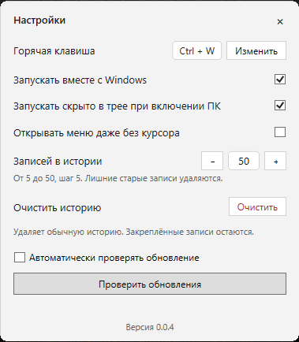
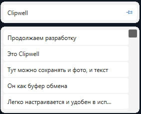

# Clipwell

**История буфера обмена для Windows — нужные тексты и изображения всегда под рукой.**

Clipwell запоминает скопированное, помогает быстро вернуться к нужной записи и вставить её одним кликом. Работает в фоне и открывает компактное меню рядом с указателем мыши.

## Скачать

**[Скачать последнюю версию для Windows x64](https://github.com/AlemusSs/Clipwell/releases/latest/download/ClipwellSetup.exe)** · [Все выпуски](https://github.com/AlemusSs/Clipwell/releases) · [История изменений](CHANGELOG.md)

Актуальная версия: **0.0.4**, опубликована **11 ноября 2026 года**.

## Возможности

- История скопированных текстов и изображений, от 5 до 50 записей.
- Вставка выбранной записи одним кликом.
- Закреплённые записи отдельным блоком: сохраняются при очистке истории и не входят в её лимит.
- Заметки к закреплённым записям.
- Настраиваемая горячая клавиша вызова меню.
- Работа в трее, запуск вместе с Windows и скрытый запуск.
- Возможность открывать меню даже без текстового курсора.
- Локальное хранение истории и настроек.

## Скриншоты

### Настройки

### Меню истории буфера обмена

На скриншоте задано сочетание Ctrl + W. По умолчанию используется Ctrl + Shift + V; сочетание можно изменить.

## Установка и использование

1. Скачайте установщик по ссылке выше.
2. Запустите `ClipwellSetup.exe` и следуйте указаниям установщика. Установка для текущего пользователя не требует прав администратора.
3. Откройте настройки через значок Clipwell в трее, выберите сочетание клавиш и размер истории.
4. Копируйте текст или изображения как обычно. В поле ввода нажмите горячую клавишу и выберите запись для вставки.

Требуется Windows 10 версии 1809 или новее / Windows 11, x64. Установщик включает среду .NET. Установщик не подписан цифровой подписью, поэтому Windows может показать предупреждение об издателе.

## Обновления

Новые версии публикуются в [GitHub Releases](https://github.com/AlemusSs/Clipwell/releases). Постоянная ссылка «Скачать последнюю версию» всегда ведёт на установщик актуального выпуска. 

Начиная с версии **0.0.4**, в приложении доступно автообновление. Автопроверка включена по умолчанию и выполняется при запуске \ каждые 6 часов. При обнаружении новой версии Clipwell предлагает обновиться: после согласия скачивает установщик, запускает установку и затем открывается в трее. При выключенной автопроверке ручной поиск продолжает работать.

## Данные и ограничения

История и настройки находятся в `%LOCALAPPDATA%\Clipwell`. Обычные тексты и изображения хранятся локально без шифрования. Для текстов, распознанных приложением как секретные по меткам буфера обмена, предусмотрены маскирование и шифрование Windows DPAPI; это не гарантирует распознавание всех паролей.

Вставка в приложения, запущенные с повышенными правами, может не работать. Если Clipwell не определяет текстовый курсор в приложении, включите «Открывать меню даже без курсора».

Этот репозиторий предназначен для распространения приложения, документации и скриншотов. Исходный код в текущей ветке не публикуется.
